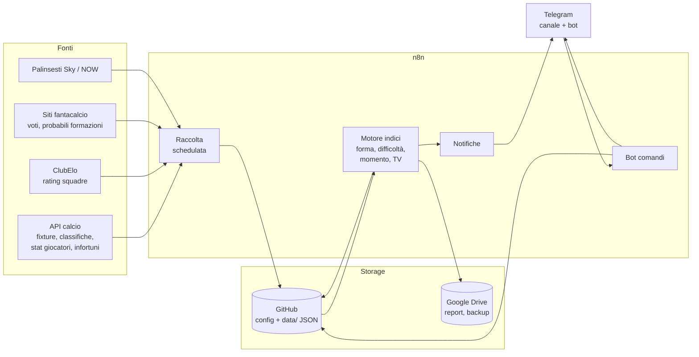

# Fanta26 — Assistente di gestione per Euroleghe Fantacalcio

> Disegno teorico del progetto. Nessuna riga di codice ancora: questo documento fissa obiettivi, architettura, fonti dati, flussi e roadmap. Le decisioni aperte sono raccolte in fondo.

---

## 1. Obiettivo

Avere, ogni settimana e senza sforzo manuale, tutte le informazioni utili per schierare la formazione Euroleghe (sistema Mantra) sui 30 giocatori della rosa monitorata:

1. **Stato di forma** di ogni giocatore (minuti, voti, bonus, trend ultime 3-5 partite).
2. **Difficoltà della prossima partita** (forza dell'avversario, casa/trasferta, contesto).
3. **Momento della squadra** di appartenenza (risultati recenti, rendimento offensivo/difensivo).
4. **Disponibilità** (infortuni, squalifiche, rischio turnover, probabile titolarità).
5. **Copertura TV**: quali partite dei "nostri" sono trasmesse su Sky / NOW e quando.

Il tutto recapitato su **Telegram**, con la possibilità di interrogare il sistema a comando.

---

## 2. Contesto e vincoli

### 2.1 Euroleghe Fantacalcio 2026/27 (cosa conta per il progetto)

- Cinque campionati coperti: Premier League, LaLiga, Bundesliga, Ligue 1, Serie A. Da questa stagione il database è personalizzabile (fino a 37 squadre disponibili).
- La **scadenza formazione** dipende dal **primo match della giornata in cui scende in campo una squadra presente nel database della lega**. Il sistema deve quindi calcolare la deadline giornata per giornata a partire dal calendario reale, non da un orario fisso.
- Modalità **Mantra**: i ruoli (Por, Dd, Ds, Dc, E, M, C, T, W, A, Pc) e i moduli contano. Il progetto non simula il regolamento Mantra, ma deve conoscere i ruoli per suggerire alternative coerenti.
- Le giornate dei cinque campionati non coincidono sempre (turni infrasettimanali, soste nazionali diverse, coppe). Il calendario va gestito "per squadra", non "per giornata".

### 2.2 Copertura TV in Italia 2026/27 (da verificare a inizio stagione e monitorare)

| Campionato | Dove si vede | Impatto sui nostri |
|---|---|---|
| Premier League | Sky Sport / NOW, in esclusiva, tutte le partite del turno | 14 giocatori su 30: quasi sempre visibili |
| Bundesliga | Sky Sport / NOW, in esclusiva | 6 giocatori: sempre visibili |
| Serie A | DAZN tutte; Sky / NOW solo 3 partite su 10 per turno | 5 giocatori: da controllare ogni turno quali 3 gare sono su Sky |
| LaLiga | DAZN (fino al 2029) | 2 giocatori: mai su NOW |
| Ligue 1 | Piattaforma Ligue1+ | 3 giocatori: mai su NOW |

Conseguenza: il modulo TV serve soprattutto a (a) dire **canale e orario** per PL e Bundesliga, (b) scoprire **quali 3 partite di Serie A** finiscono su Sky, (c) segnalare che LaLiga e Ligue 1 non sono su NOW.

### 2.3 Strumenti disponibili

- **GitHub** (questo repository): codice, configurazione, dati versionati, documentazione. Eventualmente GitHub Actions come scheduler di riserva.
- **n8n**: gira su una VM Google Cloud già esistente, gestita dal PC dell'utente. Sulla stessa VM è presente anche un'installazione di Claude Code. Orchestra raccolta dati, calcoli, invio messaggi e risposta ai comandi.
- **Telegram**: esiste già un canale collegato a n8n che smista comandi. Il progetto si aggancia a quel bot aggiungendo i propri comandi (prefisso `/f_` per non confliggere con quelli esistenti) e un canale o topic dedicato per le notifiche.
- **Google Drive / Google Sheets**: un foglio Google tiene lo storico delle performance (una riga per giocatore per giornata), leggibile da telefono e aggiornato da n8n. Drive ospita anche i report settimanali e i backup.
- **Claude API**: usato dal livello AI (sezione 5.7). Gira sui crediti gratuiti dell'account API, che sono separati dall'abbonamento Max: Max copre le chat e Claude Code, non le chiamate fatte da n8n.

---

## 3. La rosa monitorata

30 giocatori, 21 squadre, 5 campionati.

| Ruolo Mantra | Giocatore | Squadra | Campionato | Su NOW? |
|---|---|---|---|---|
| Por | Hornicek | Newcastle | Premier League | Sì |
| Por | Verbruggen | Brighton | Premier League | Sì |
| Por | Maignan | Milan | Serie A | Solo se tra le 3 di Sky |
| Dd Dc | Mitchell J. | Racing Strasburgo | Ligue 1 | No |
| Dd Ds E | Favasuli | Napoli | Serie A | Solo se tra le 3 di Sky |
| Dd Ds E | Dedic | Newcastle | Premier League | Sì |
| Dd Dc | Quansah | Bayer Leverkusen | Bundesliga | Sì |
| Dd Ds E | Dalot | Manchester United | Premier League | Sì |
| Ds Dc | Boscagli | Brighton | Premier League | Sì |
| Ds E | Romero C. | Villarreal | LaLiga | No |
| Dc | Guehi | Manchester City | Premier League | Sì |
| Dc | Dunk | Brighton | Premier League | Sì |
| Dc | Koch | Eintracht Francoforte | Bundesliga | Sì |
| Dc | Gabriel Magalhaes | Arsenal | Premier League | Sì |
| M C | Promel | Stoccarda | Bundesliga | Sì |
| M C | Kamara | Aston Villa | Premier League | Sì |
| M C | Hojbjerg | Olympique Marsiglia | Ligue 1 | No |
| C | Mainoo | Manchester United | Premier League | Sì |
| C T | Da Cunha | Como | Serie A | Solo se tra le 3 di Sky |
| C T | Szoboszlai | Liverpool | Premier League | Sì |
| T | El Khannouss | Stoccarda | Bundesliga | Sì |
| T A | Paz N. | Como | Serie A | Solo se tra le 3 di Sky |
| T | Uzun | Eintracht Francoforte | Bundesliga | Sì |
| W T | Buendia | Aston Villa | Premier League | Sì |
| A | Yildiz | Juventus | Serie A | Solo se tra le 3 di Sky |
| A | Barcola B. | Liverpool | Premier League | Sì |
| A | Marmoush | Tottenham | Premier League | Sì |
| A | Williams I. | Athletic Bilbao | LaLiga | No |
| Pc | Lepaul | Rennes | Ligue 1 | No |
| Pc | Guirassy | Borussia Dortmund | Bundesliga | Sì |

Distribuzione: Premier League 14, Bundesliga 6, Serie A 5, Ligue 1 3, LaLiga 2.

La rosa vivrà in un file versionato (`config/rosa.yaml`), unica fonte di verità. Ogni giocatore avrà gli ID delle fonti esterne, così i flussi non dipendono mai dal nome (che cambia tra fonti: "Paz N." vs "Nico Paz").

```yaml
# esempio di voce in config/rosa.yaml
- id: paz_n
  nome: "Nico Paz"
  ruoli: [T, A]
  squadra: "Como"
  campionato: SA          # PL | SA | BL | L1 | LL
  ids:
    api_football: 000000  # da valorizzare al primo setup
    fantacalcio: 0000
  note: ""
```

---

## 4. Architettura ad alto livello



Principio guida: **n8n non tiene stato**. Legge la rosa e gli snapshot da GitHub, calcola, scrive di nuovo su GitHub (commit automatico) e manda i messaggi. Così ogni numero mostrato su Telegram è ricostruibile e ogni cambio di rosa è un commit.

---

## 5. Componenti

### 5.1 Registro rosa e configurazione (GitHub)

- `config/rosa.yaml`: i 30 giocatori con ruoli, squadra, campionato, ID esterni.
- `config/squadre.yaml`: le 21 squadre con ID esterni, nome usato da Sky nei palinsesti, fuso orario.
- `config/regole.yaml`: pesi degli indici, soglie di alert, orari di invio.
- Modifiche via pull request o via comando Telegram (`/aggiungi`, `/rimuovi`) che apre un commit.

### 5.2 Raccolta dati (n8n, schedulata)

| Dato | Fonte primaria | Fonte di riserva | Frequenza |
|---|---|---|---|
| Calendario e risultati delle 21 squadre | API calcio (API-Football o football-data.org) | — | 1 volta al giorno + dopo ogni partita |
| Classifiche dei 5 campionati | API calcio | — | 1 volta al giorno |
| Rating forza squadre | ClubElo (CSV pubblico, gratuito) | classifica + differenza reti | 1 volta a settimana |
| Statistiche giocatore per partita (minuti, gol, assist, cartellini, rating) | API calcio | scraping FBref / Sofascore | dopo ogni partita |
| Voti fantacalcio ufficiali e bonus/malus | Sito fantacalcio (scraping o export manuale) | rating API calcio come proxy | dopo ogni giornata |
| Infortuni e squalifiche | API calcio (endpoint injuries) | Transfermarkt | 2 volte al giorno |
| Probabili formazioni | Siti fantacalcio / stampa sportiva | formazioni ufficiali API 1h prima | giovedì, venerdì, e 1h pre-match |
| Palinsesto Sky / NOW | Pagine programmazione NOW e Sky Sport; articoli settimanali "Calcio estero live Sky e NOW" | inserimento manuale via Telegram | 2 volte a settimana |

Ogni raccolta salva uno snapshot JSON in `data/<tipo>/<data>.json` sul repository. Gli snapshot sono la memoria del sistema.

### 5.3 Motore degli indici (n8n, codice JS in nodi Function o script Python richiamato)

Cinque indici per giocatore, tutti normalizzati su scala 0-100, più un semaforo.

**Forma giocatore (FG)**
- Media pesata delle ultime 5 presenze: minuti giocati, voto/rating, bonus (gol, assist, clean sheet per Por/Dc), malus (cartellini, gol subiti, rigori sbagliati).
- Peso decrescente: ultima partita conta più della quinta.
- Penalità se ha saltato le ultime gare (0 minuti = segnale negativo, non "neutro").

**Difficoltà prossima partita (DP)**
- Differenza di rating Elo tra la squadra del giocatore e l'avversario, corretta per casa/trasferta.
- Aggiustamenti: avversario che segna/subisce molto (per attaccanti vs difensori), impegno europeo infrasettimanale (rischio turnover), derby o partita decisiva.
- Output: Facile / Media / Difficile con il valore numerico.

**Momento squadra (MS)**
- Ultimi 5 risultati (punti), gol fatti e subiti, trend Elo delle ultime 4 settimane.
- Separato in "momento offensivo" e "momento difensivo": utile perché un Por/Dc vive di clean sheet, un A/Pc di gol.

**Disponibilità e titolarità (DT)**
- Stato: Ok / In dubbio / Infortunato / Squalificato.
- Probabilità di partire titolare, stimata da: probabili formazioni, minuti nelle ultime gare, presenza nel turno precedente, calendario ravvicinato.

**Indice TV (TV)**
- Sì/No/Da confermare + canale e orario. Non pesa nel consiglio di formazione, ma compare in ogni report.

**Semaforo di schieramento**
- Combina FG, DP, MS, DT con pesi configurabili in `config/regole.yaml`.
- Verde: schiera. Giallo: valuta alternative. Rosso: evita o controlla prima della deadline.
- Il calcolo dei pesi è dichiarato e rivedibile: nessun modello opaco nella prima versione.

### 5.4 Storage e versionamento

- **GitHub**: configurazione, snapshot JSON, indici calcolati (`data/indici/<giornata>.json`), report in markdown (`reports/<giornata>.md`). I commit automatici usano un'utenza bot dedicata.
- **Google Sheets** (`Fanta26 - Performance`): storico leggibile delle performance. Un foglio `giornate` con una riga per giocatore per giornata (voto, bonus, minuti, FG, DP, MS, DT, semaforo, esito reale), un foglio `rosa` che rispecchia `config/rosa.yaml` e un foglio `riepilogo` con medie e trend. n8n scrive dopo ogni giornata; GitHub resta la fonte di verità, il foglio è la vista comoda.
- **Google Drive**: copia del report settimanale (PDF o markdown) e backup mensile della cartella `data/`.
- Retention: gli snapshot giornalieri si compattano a fine mese in un unico file per tipo.

### 5.5 Notifiche Telegram (canale privato)

| Messaggio | Quando | Contenuto |
|---|---|---|
| **Report giornata** | 48h prima della deadline formazione | Per ogni giocatore: semaforo, FG, DP, MS, DT, avversario, orario, TV. Ordinato per ruolo Mantra. Sezione "alternative consigliate" per i rossi. |
| **Alert disponibilità** | Appena cambia lo stato | "Guirassy: in dubbio (problema muscolare), fonte X, aggiornato alle HH:MM". |
| **Promemoria deadline** | 3h e 1h prima della deadline | Riepilogo dei gialli/rossi non ancora chiariti + link rapido alla formazione. |
| **Formazioni ufficiali** | Circa 1h prima di ogni match | Titolare / panchina / fuori rosa per i nostri giocatori in quella partita. |
| **Guida TV settimanale** | Giovedì | Elenco partite dei nostri su Sky/NOW con canale e orario, più elenco di quelle non trasmesse. |
| **Bilancio post-giornata** | Lunedì o dopo l'ultima partita | Voti e bonus presi, chi ha reso sopra/sotto attese, aggiornamento FG. |

Regola anti-rumore: un alert per evento, con aggiornamento del messaggio esistente (edit) invece di un nuovo messaggio quando cambia solo il dettaglio.

### 5.6 Comandi del bot (n8n, Telegram Trigger)

Il bot è quello già collegato a n8n. Il workflow esistente che smista i comandi instrada tutto ciò che inizia con `/f_` verso il workflow `10-bot` di questo progetto; qui sotto i comandi sono scritti senza prefisso per leggibilità.

- `/rosa` — semaforo compatto di tutti i 30.
- `/g <nome>` — scheda giocatore: indici, ultime 5 gare, prossima partita, TV.
- `/prossime` — le partite dei nostri nei prossimi 7 giorni, con orario e TV.
- `/tv` — solo le gare su Sky/NOW della settimana.
- `/deadline` — quando scade la formazione della giornata in corso.
- `/ruolo <sigla>` — confronto tra i giocatori di uno stesso ruolo Mantra (es. `/ruolo Dc`).
- `/aggiungi`, `/rimuovi` — modifica della rosa, con conferma, che produce un commit.
- `/tvmanuale <partita> <canale> <orario>` — inserimento a mano del palinsesto quando lo scraping fallisce.

### 5.7 Livello AI (opzionale, fase successiva)

Un nodo LLM riceve gli indici già calcolati e produce il testo del report in linguaggio naturale, con i "perché" (es. "Szoboszlai: forma alta, ma il Liverpool gioca in Champions martedì e il Chelsea in trasferta è la gara più difficile del turno"). L'AI **non** calcola i numeri, li spiega. Così il costo resta basso e le raccomandazioni restano verificabili.

Costo stimato: una chiamata a settimana per il report più una al giorno per gli alert, con circa 5.000 token in ingresso e 1.500 in uscita ciascuna. Con Claude Opus 5.5 (4 $ per milione di token in ingresso, 20 $ in uscita) sono pochi centesimi a settimana: i crediti gratuiti bastano per tutta la stagione. La chiave API vive nelle credenziali di n8n.

---

## 6. Flussi n8n previsti

| Workflow | Trigger | Passi | Scrive |
|---|---|---|---|
| `01-calendario` | Cron giornaliero 07:00 | Fixture 21 squadre → normalizza fuso Europa/Roma → calcola deadline giornata | `data/fixtures/`, `data/deadline.json` |
| `02-squadre` | Cron giornaliero 07:15 | Classifiche + Elo + ultimi 5 risultati → MS per squadra | `data/squadre/` |
| `03-giocatori` | Dopo ogni partita conclusa (polling 30 min nelle finestre gara) | Stat per giocatore → FG | `data/giocatori/` |
| `04-disponibilita` | Cron 09:00 e 18:00 | Infortuni + squalifiche + probabili → DT → diff con stato precedente → alert | `data/stato/`, Telegram |
| `05-tv` | Cron giovedì 10:00 e sabato 08:00 | Palinsesto Sky/NOW → match dei nostri → TV | `data/tv/` |
| `06-report` | Deadline − 48h | Legge tutti gli indici → semaforo → report markdown → Telegram + Drive | `reports/`, Telegram, Drive |
| `07-promemoria` | Deadline − 3h, − 1h | Ricalcolo rapido DT → invio | Telegram |
| `08-formazioni` | Kickoff − 60 min per ogni match | Formazioni ufficiali → chi è titolare | Telegram |
| `09-bilancio` | Fine ultima partita della giornata + 6h | Voti/bonus → aggiornamento FG → riepilogo | `data/giornate/`, Telegram |
| `10-bot` | Telegram Trigger | Parsing comando → lettura dati da GitHub → risposta | Telegram, eventualmente `config/` |
| `99-salute` | Cron ogni 6h | Verifica che le fonti rispondano e che gli snapshot siano freschi; altrimenti avvisa | Telegram (solo in caso di errore) |

---

## 7. Settimana tipo (giornata con deadline venerdì sera)

```
Lun   09-bilancio: voti della giornata precedente, FG aggiornata
Mar   04-disponibilita (2x), 01/02 quotidiani
Mer   idem + eventuali gare infrasettimanali (03-giocatori)
Gio   05-tv (guida TV settimanale) + 06-report (deadline − 48h)
Ven   04-disponibilita, 07-promemoria (−3h, −1h), 08-formazioni per gare del venerdì
Sab   05-tv (conferma), 08-formazioni, 03-giocatori dopo ogni gara
Dom   08-formazioni, 03-giocatori
```

La deadline viene sempre ricalcolata dal calendario: se la giornata apre con squadre non presenti nel database della lega, il report e i promemoria slittano di conseguenza.

---

## 8. Struttura proposta del repository

```
fanta26/
├── README.md
├── docs/
│   ├── 01-disegno-progetto.md      ← questo documento
│   ├── 02-fonti-dati.md            ← dettaglio endpoint, campi, limiti
│   ├── 03-indici.md                ← formule e pesi, con esempi numerici
│   └── 04-runbook.md               ← cosa fare quando qualcosa si rompe
├── config/
│   ├── rosa.yaml
│   ├── squadre.yaml
│   └── regole.yaml
├── n8n/
│   └── workflows/*.json            ← export dei workflow, versionati
├── scripts/                        ← eventuali script Python/JS richiamati da n8n
├── data/
│   ├── fixtures/  squadre/  giocatori/  stato/  tv/  indici/  giornate/
│   └── deadline.json
└── reports/
    └── <stagione>-g<NN>.md
```

---

## 9. Fonti dati: valutazione

| Fonte | Cosa dà | Costo / limiti | Rischio | Uso previsto |
|---|---|---|---|---|
| API-Football (api-sports) | Fixture, classifiche, stat giocatore per partita, infortuni, formazioni ufficiali, tutti e 5 i campionati | Gratis: 100 richieste/giorno, 10/min. Piano Pro ~19 $/mese per 7.500/giorno | Basso; il piano gratuito è stretto ma sufficiente per 21 squadre se si ottimizzano le chiamate | Fonte primaria |
| football-data.org | Fixture, classifiche, risultati (con ritardo) per i 5 campionati | Gratis: 10 richieste/min, 12 competizioni | Nessuna stat per giocatore né infortuni | Riserva per calendario e classifiche |
| ClubElo | Rating Elo storico di tutti i club | Gratis, CSV via HTTP | Aggiornamento settimanale | Difficoltà partita |
| Sito Euroleghe / fantacalcio | Voti ufficiali, bonus/malus, probabili formazioni, ruoli Mantra | Nessuna API; scraping soggetto ai termini d'uso | Medio-alto: struttura pagine che cambia, possibili blocchi | Voti ufficiali e probabili; prevedere sempre l'alternativa via API |
| Pagine programmazione NOW / Sky Sport, articoli settimanali di palinsesto | Partite trasmesse, canale, orario | Gratis, scraping HTML | Medio: formato non stabile | Modulo TV, con fallback manuale via bot |
| Transfermarkt | Infortuni con rientro stimato | Scraping | Medio | Riserva per disponibilità |

Stima consumo API-Football sul piano gratuito: circa 20 chiamate al giorno nei giorni feriali (fixture e classifiche per 5 campionati, infortuni per 5 campionati) e circa 40-60 nei giorni di gara (stat per ogni partita dei nostri, formazioni ufficiali). Rientra nei 100, ma con poco margine: il piano Pro va messo in preventivo se si aggiungono giocatori o si vogliono aggiornamenti più frequenti.

---

## 10. Sicurezza e operatività

- Chiavi API, token del bot Telegram e credenziali Drive vivono **solo** nelle credenziali di n8n; nel repository mai, nemmeno in file di esempio con valori reali.
- Il bot Telegram accetta comandi solo dagli ID utente elencati in `config/regole.yaml`.
- Il commit automatico su GitHub usa un token con permessi limitati a questo repository.
- Ogni workflow ha un ramo di errore che manda un messaggio nel canale "sistema" di Telegram, separato da quello dei consigli.
- Il workflow `99-salute` segnala snapshot più vecchi di 36 ore: meglio un avviso "dati stantii" che un consiglio sbagliato.

---

## 11. Roadmap

**Fase 0 — Fondamenta (1 settimana)**
- Creare `config/rosa.yaml` e `config/squadre.yaml` con gli ID delle fonti.
- Attivare API-Football (piano gratuito), bot Telegram, canale privato, credenziali n8n.
- Workflow `01-calendario` e `02-squadre`. Primo messaggio: "prossime partite dei nostri con deadline".

**Fase 1 — MVP utile (2 settimane)**
- `04-disponibilita` con alert.
- `06-report` con semaforo basato su DP, MS e DT (senza forma giocatore).
- `05-tv` con la guida settimanale, anche se inizialmente alimentata a mano via `/tvmanuale`.

**Fase 2 — Forma e bilancio (2 settimane)**
- `03-giocatori` e `09-bilancio`: FG completa con stat per partita e, se possibile, voti ufficiali.
- Comandi `/rosa`, `/g`, `/prossime`, `/tv`, `/deadline`, `/ruolo`.

**Fase 3 — Automazione TV e formazioni (2 settimane)**
- Scraping del palinsesto Sky/NOW con confronto contro i match dei nostri.
- `08-formazioni` con formazioni ufficiali un'ora prima.

**Fase 4 — Rifiniture (continuativa)**
- Nodo LLM per il report in linguaggio naturale.
- Report su Drive in PDF, backup mensile.
- Revisione dei pesi degli indici confrontando semaforo e voti reali a fine girone.

---

## 12. Decisioni prese e decisioni aperte

**Prese**

- **Hosting n8n**: VM Google Cloud esistente, con Claude Code installato sulla stessa macchina. I webhook Telegram funzionano già (il bot smista comandi).
- **Telegram**: si riusa il bot e il canale esistenti; i comandi del progetto hanno prefisso `/f_`.
- **Piano API-Football**: si parte dal piano gratuito (100 richieste al giorno) ottimizzando le chiamate; passaggio a Pro solo se il consumo lo richiede.
- **Claude API**: crediti gratuiti dell'account API, non l'abbonamento Max. Modello Claude Opus 5.5 per il report; costo trascurabile.
- **Storico performance**: foglio Google `Fanta26 - Performance` aggiornato da n8n, con GitHub come fonte di verità.

**Aperte**

1. **Fonte per i voti ufficiali**: scraping del sito Euroleghe (fragile) oppure usare i rating dell'API come proxy e inserire i voti a mano una volta a settimana?
2. **Notifiche**: nello stesso canale dei comandi, o in un canale/topic separato per i consigli e uno per gli errori di sistema? Il disegno ne prevede due.
3. **Livello AI**: si vuole da subito il testo "spiegato" o bastano indici e semaforo nella prima versione?
4. **Database della lega**: quali delle 37 squadre sono attive nella vostra lega? Serve per calcolare correttamente la deadline.
5. **Accesso alla VM da Claude Code**: per lavorare direttamente sulla VM servirà una sessione avviata dalla VM stessa o dal PC che la gestisce (vedi sezione 13).

---

## 13. Come lavorare sulla VM con Claude Code

La sessione cloud di Claude Code (quella che ha scritto questo documento) gira in un container isolato: non ha `gcloud`, chiavi SSH né credenziali Google, quindi non può raggiungere la VM né il PC. Tre modi per collegare i due mondi:

1. **Sessione sulla VM** (consigliato per configurare n8n): sulla VM è già installato Claude Code. Avviarlo lì, nella cartella del progetto clonato, e da lì può leggere i workflow di n8n esportati, controllare i servizi (`systemctl`, `docker ps`) e modificare la configurazione. Con `claude remote-control` la sessione compare anche nell'app Claude Code e si può guidare dal telefono.
2. **Sessione dal PC** (Claude Desktop o `claude remote-control` in un terminale): il PC ha già accesso alla VM, quindi Claude può usare `gcloud compute ssh` o SSH diretto per ispezionarla.
3. **Sessione cloud con credenziali** (solo se serve automazione senza PC acceso): aggiungere all'ambiente cloud un segreto con una chiave SSH o un service account Google con permessi minimi (`compute.instances.get`, SSH via OS Login). Da valutare, perché mette credenziali della VM in un ambiente esterno.

Primo passo consigliato: da una sessione sulla VM, esportare i workflow n8n esistenti (in particolare quello che smista i comandi Telegram) nella cartella `n8n/workflows/` di questo repository, così il progetto parte da ciò che c'è davvero.

---

## Fonti consultate per questo disegno

- Copertura Sky/NOW 2026/27: [NOW — Premier League](https://www.nowtv.it/sport/calcio/premier-league), [NOW — Bundesliga](https://www.nowtv.it/sport/calcio/bundesliga), [NOW — Serie A](https://www.nowtv.it/sport/calcio/serie-a), [Programmi Sky — Premier League](https://programmi.sky.it/sport/calcio/premier-league), [Guida calcio in TV 2026/27](https://tech.everyeye.it/notizie/calcio-tv-2026-27-guida-definitiva-dazn-sky-prime-video-885775.html), [Live Soccer TV — NOW Italia](https://www.livesoccertv.com/channels/now-tv-italy/), [Digital-News — palinsesto calcio estero Sky e NOW](https://www.digital-news.it/palinsesti/sky-sport-e-calcio/sky-sport-hd/9873/calcio-estero-live-sky-e-now-24-27-aprile-2026-premier-league-ligue-1-bundesliga)
- Euroleghe 2026/27: [Fantacalcio.it — Mantra ed Euroleghe, novità 2026/27](https://www.fantacalcio.it/news/redazionali/04_08_2026/mantra-ed-euroleghe-fantacalcio-2026-27-495846), [Fantacalcio.it — regolamento Mantra](https://www.fantacalcio.it/regolamenti/sistema-mantra), [Pazzi di Fanta — listone Euroleghe 2026/27](https://www.pazzidifanta.com/consigli-fantacalcio/euroleghe-uscita-listone-ruoli-quotazioni-regolamento-458529)
- API dati: [API-Football su FreeAPIHub](https://freeapihub.com/apis/api-football), [Survey API calcio 2026](https://dev.to/leomarsh886/a-survey-of-public-apis-for-building-a-football-live-score-site-in-2026-part-3-football-data-api-16hi), [football-data.org — documentazione](https://www.football-data.org/documentation/api), [football-data.org free tier 2026](https://www.thestatsapi.com/blog/football-data-org-free-tier-limits-2026)
